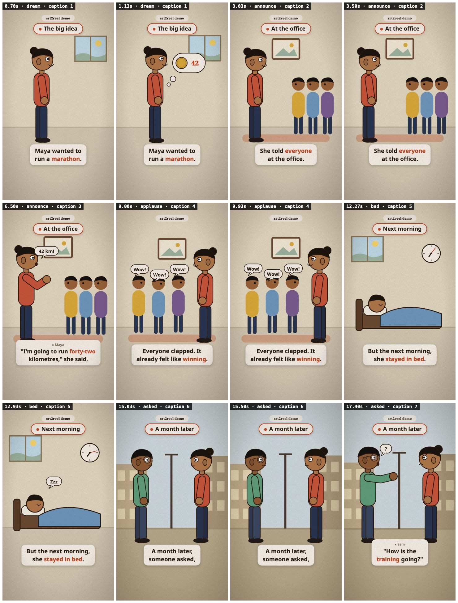
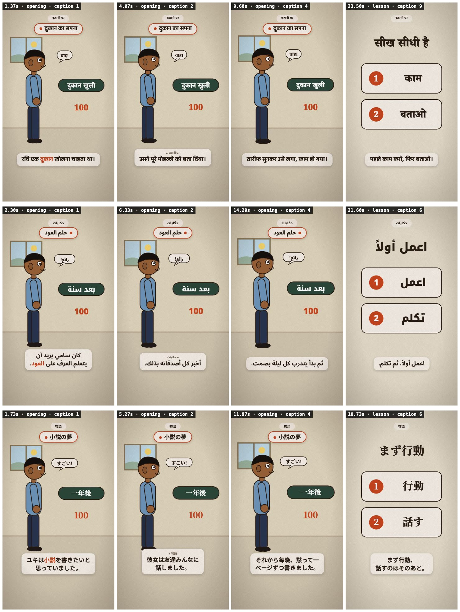
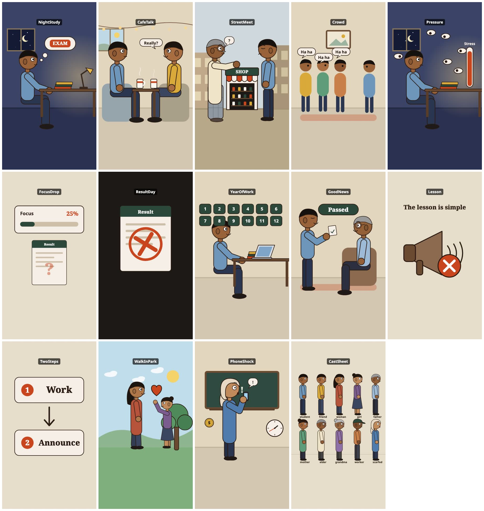

# srt2reel

A voice file and its SRT in, a finished animated story video out. In any language.

srt2reel is a skill for coding agents (Claude Code, claude.ai, and other agents that read the Agent Skills format). You give the agent a narration recording and its subtitle file. It draws the scenes, times the captions to the voice, renders the video and checks the result.



## Now

- State: built and tested on one Mac on 2026-11-18. The repository went public the same day. There is no release, marketplace listing or demo video yet.
- Version: 0.1.0.
- Tests: 110 unit tests pass (`pnpm test`), type-check is clean.
- Gate: a fresh agent given only the skill folder built a complete Hindi video with no script failures. What it found and what was changed is in [docs/research/05-skill-test.md](docs/research/05-skill-test.md).
- Next: finish the three real videos for a speedsharma page (phase 01, stories and voices are ready), then decide on a public release.

See [WORKLIST.md](WORKLIST.md) for the short list and [phases/README.md](phases/README.md) for the gates.

## What it makes

- Vertical 1080x1920 videos for Reels, Shorts and TikTok, or landscape 1920x1080 videos for YouTube.
- Flat-vector scenes drawn for the story: people who blink, breathe, walk and talk, rooms, streets, and cards with numbers, bars, stamps and lists.
- Captions that are the SRT's own words, timed to the pauses in the voice, with key words in colour.
- A tag at the top naming each scene, soft sound effects, and a quiet ambient bed.
- One MP4 that meets the upload specs of Instagram, Facebook and YouTube, with loudness evened to -14 LUFS.

It does not write the story and it does not make the voice. Those are yours.

## Any language

The script of the SRT decides the fonts, the text direction and how lines break. Nothing is tied to one language.



Tested by rendering: English, Hindi, Arabic (right-to-left) and Japanese. Fonts are mapped for 30 scripts, including Bengali, Tamil, Telugu, Thai, Chinese, Korean, Hebrew, Cyrillic and Ethiopic; see [languages.md](skills/srt2reel/references/languages.md). Scripts other than the four above have unit tests for detection and font choice but have not been rendered yet.

## How it works

The agent runs five commands. Each one prints what it did and what to do next.

| Step | Command | What it does |
|---|---|---|
| 1 | `doctor.ts` | Checks Node, ffmpeg, a package manager, a browser, disk space. Stops early if the machine cannot render. |
| 2 | `init.ts` | Creates the project, measures the voice, finds the real pauses, writes captions from the SRT, installs fonts for the language. |
| 3 | (the agent) | Plans scenes and writes two files: `story.json` and `scenes.tsx`. |
| 4 | `check.ts` | Compares caption wording with the SRT, checks timing and fonts, compiles the scene code. |
| 5 | `stills.ts` | Renders a frame after every cut and in every caption, tiled into contact sheets the agent looks at. `--grid` draws the safe zones on them. |
| 6 | `render.ts` | Renders, evens out loudness, and verifies the finished file. |

The captions are copied from the SRT by a program and compared with it by a program. The agent can restyle and retime them but cannot change a word. Why: [decision 0002](docs/decisions/0002-captions-come-from-the-srt.md).

The pieces the agent draws with:



## Install

You need Node.js 22.18 or newer and ffmpeg. The first video also needs network access to the npm registry.

Claude Code, as a plugin. The plugin files pass `claude plugin validate`; installing this way from GitHub has not been tried yet:

```
/plugin marketplace add speedsharmaai/srt2reel
/plugin install srt2reel@srt2reel
```

Claude Code, as a plain skill, from a copy of this repository:

```
cp -R skills/srt2reel ~/.claude/skills/
```

claude.ai: run `pnpm run package`, then upload `dist/srt2reel.zip` as a custom skill. Whether its sandbox has Node 22.18+, ffmpeg and npm access has not been tested; `doctor.ts` reports what is missing.

Other agents that read Agent Skills (Codex, Gemini CLI, Cursor, Copilot, OpenCode): copy `skills/srt2reel` into the agent's skills folder, usually `.agents/skills/`.

## Use

Give the agent the two files and say what you want:

> Make a video from voice.mp3 and voice.srt. Page name: Kahani Ghar.

> इस आवाज़ और SRT से वीडियो बना दो।

> Make a landscape YouTube video from lesson.wav and lesson.srt.

The agent answers in the language you write in. Options it understands: a page name for the watermark, a theme (`paper`, `mint`, `sky`), the format (`portrait` or `landscape`), your own pictures to place in scenes.

## Long videos

A landscape video can run to about fifteen minutes. The agent writes a dozen reusable scene kinds and varies them through data instead of drawing every scene by hand; see [long-videos.md](skills/srt2reel/references/long-videos.md).

Measured on an 8-core Apple Silicon laptop:

| Video | Scenes | Render time | File |
|---|---|---|---|
| 36 s portrait | 11 | 37 s | 8 MB |
| 2 min 54 s landscape | 55 | 3 min 22 s | 46 MB |
| 15 min landscape | 286 | 17 min 37 s | 242 MB |

The two long rows are stress tests made by repeating the 36 s example voice, to measure the pipeline. They are not real long-form stories. A small cloud machine will be several times slower.

## What the scripts touch

Skills run code on your machine, so here is all of it. Every script is TypeScript in [skills/srt2reel/scripts](skills/srt2reel/scripts) and is short enough to read.

- Network: none of the scripts open a connection themselves. `init.ts` and `check.ts` run your package manager to install Remotion, React, TypeScript and font packages from the npm registry. Remotion downloads its browser on the first render if you have none.
- Files written: only inside the project folder you name.
- Files read: the voice file, the SRT, and the project folder.
- Environment: two optional variables, both only to find a browser: `SRT2REEL_BROWSER`, which you set to point at one, and `PLAYWRIGHT_BROWSERS_PATH`, which Playwright sets. Nothing else is read.
- Programs run: `ffmpeg`, `ffprobe`, your package manager, the project's `tsc`, and a Chromium browser.

One file outside the skill does use the network. `examples/make-example.ts` is a development helper that makes test voices; if you run it with an `eleven:` voice it sends the text to ElevenLabs with the key in `ELEVENLABS_API_KEY`. The skill never runs it.

## Limits

- Characters are simple flat figures seen from the side. They stand, sit, walk, point, wave and change expression. They do not run, turn around or pick things up.
- No word-by-word caption highlighting. An SRT has a time per caption, not per word; see [the worklist](WORKLIST.md).
- The safe margins for phone apps are working defaults, not published figures. [Decision 0006](docs/decisions/0006-layout-margins-are-defaults.md).
- The agent draws the scenes, so two agents will draw different videos from the same files, and quality depends on the agent.
- Remotion, which does the rendering, is free for individuals and for companies of up to three people. Larger companies need a licence: https://www.remotion.dev/docs/license

## Development

```
pnpm install
pnpm test          # unit tests, run by Node's own test runner
pnpm typecheck
pnpm run package   # dist/srt2reel.zip
```

Layout:

```
skills/srt2reel/   the skill: SKILL.md, references/, scripts/, template/, assets/
tests/             unit tests for the scripts
examples/          test inputs in four languages, and how they were made
docs/research/     what was looked up before building, with sources
docs/decisions/    why things are the way they are
```

To rebuild the English example:

```
node skills/srt2reel/scripts/init.ts examples/en/project --voice examples/en/voice.mp3 --srt examples/en/voice.srt
cp examples/en/story.json examples/en/scenes.tsx examples/en/project/src/
node skills/srt2reel/scripts/render.ts examples/en/project
```

## Licence

MIT. See [LICENSE](LICENSE).
